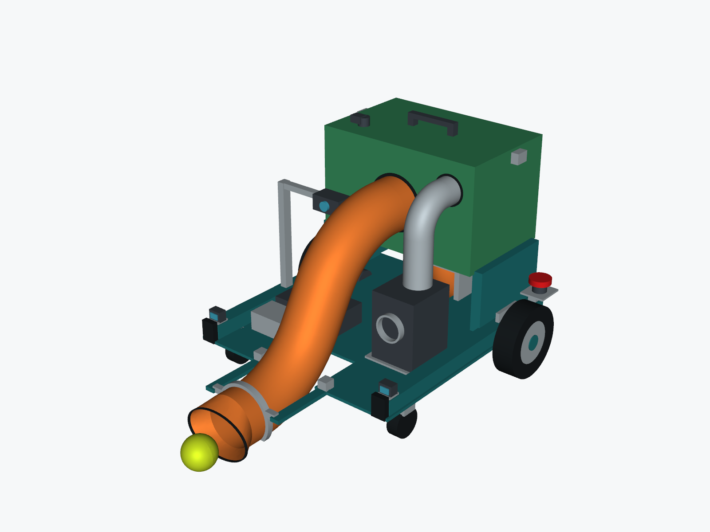
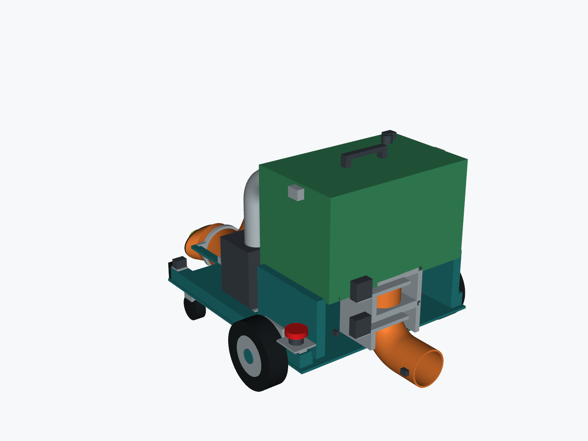

# V4: Suction Intake and Automatic Ball Dispensing

Review draft, 11 October 2026. All CAD dimensions are millimetres and are proposed
layout values, not measured hardware constants or approved firmware calibration.

This version replaces the manual-only unloading in the earlier suction concept
with automatic, individually confirmed ball dispensing. Opening the storage lid
is for maintenance and clearing jams, not the normal replenishment workflow.




## Mechanism

Collection: front oval nozzle -> hollow 100 mm ball pipe -> sealed rear receiver.
Air leaves through a retention screen and filter toward a separate blower.

Dispensing: sloped internal hopper -> upper servo isolation gate -> one-ball
metering chamber -> lower servo release gate -> rear outlet -> exit sensor.
The two gates are intended to stay closed during suction collection. They open
in sequence for one ball, with collection stopped and receiver pressure equalized.
The [automatic dispensing document](AUTOMATIC_DISPENSING.md) defines the proposed
sequence, interlocks, confirmation, and required bench evidence.

## Files and Fusion

- [STEP assembly](cad/Padel_Collector_V4_Auto_Dispense.step): open in Fusion with
  File > Open > Open from my computer, or upload through the Data Panel.
- [GLB preview](cad/Padel_Collector_V4_Auto_Dispense.glb): mesh for compatible viewers.
- [Cutaway](images/suction-v4-cutaway.png): receiver wall/lid removed for illustration;
  the exported assembly retains its enclosure.
- [Side view](images/suction-v4-side.png) and [top view](images/suction-v4-top.png).
- [Geometry checks](validation/geometry-checks.json).
- [Materials and component specifications](../../hardware/suction-v4/MATERIALS_AND_COMPONENTS.md)
  and [CSV bill of materials](../../hardware/suction-v4/BOM.csv).
- [Compatibility review](INTEGRATION_REVIEW.md): unresolved differences from the
  team's current roller/four-motor architecture.

STEP transfers solid geometry and component names, not a native Fusion feature
timeline. Save the imported design in Fusion and export an .f3d if needed.

## Proposed layout

| Feature | CAD value |
| --- | --- |
| Overall envelope | Approximately 552 wide x 829 long x 469 high |
| Main ball pipe | 100 mm inside diameter; 4 mm nominal wall |
| Pickup opening | 140 x 90 mm inside |
| Main pipe bends | 200 mm centreline radius; two 60-degree bends |
| Receiver inlet axis | Approximately 325 mm above the court |
| Receiver | 360 x 230 x 216 mm outer shell; floor at 222 mm |
| Gate centre heights | Upper 230 mm; lower 150 mm |
| Metering passage | 76 mm inside diameter; 76 mm clear height between closed plates |
| Proposed slide stroke | 94 mm; actuator/linkage design remains to be proven |
| Rear outlet | 76 mm inside diameter; 80 mm bend radius |
| Collection target | Initially 10 balls; usable capacity/filling need testing |

The elevated receiver makes room for the dispenser. Its effect on mass and
tipping resistance must be measured before final chassis selection. The reference
balls are illustrations, not a packing, gravity or pneumatic simulation.

## Rebuild

From the repository root, use a separate CAD environment:

```bash
python -m venv .venv-cad
# Activate .venv-cad for your shell, then:
python -m pip install -r mechanical/suction-v4/source/requirements.txt
python mechanical/suction-v4/source/build_suction_robot.py
```

The generator writes to this proposal's cad/, images/, and validation/ folders.
build_robot.py supplies shared shape/render helpers from the earlier concept;
run build_suction_robot.py for V4. No laptop runtime or ESP32 firmware uses these
dependencies. The design is partly parameterized; related explicit coordinates
also need updating when changing layout dimensions.

## Validation Boundary

The STEP round trip preserves 94 valid components and total solid volume. A
67.7 mm reference sphere clears the main pipe at 25 sampled centreline positions
and the outlet at five sampled bend positions. Both gate plates cover their
ports when closed and clear them at the modeled 94 mm stroke. These checks do
not prove moving-ball clearance everywhere, feeder singulation, sealing,
actuator kinematics, strength, suction performance or stable driving.

Motors, servos, valve, filter and sensor bodies are supplier-replacement envelopes.
Detailed seals, spring returns, linkage joints, connectors, pressure rating,
fasteners and manufacturing tolerances are incomplete. The model is not a
fabrication release, and the automatic mechanism has not been built or tested.
